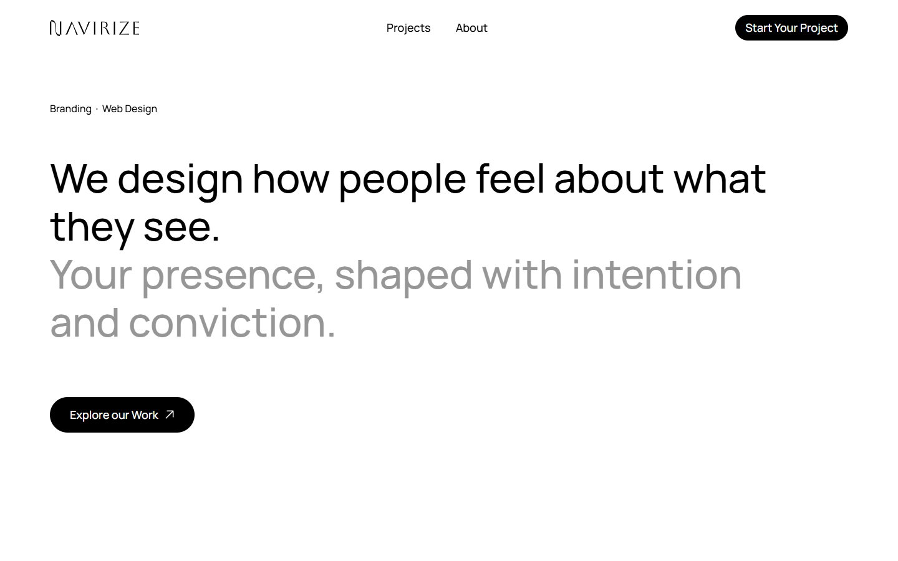
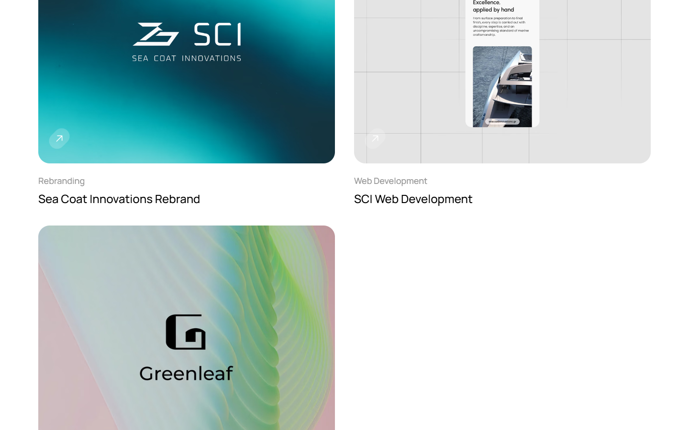
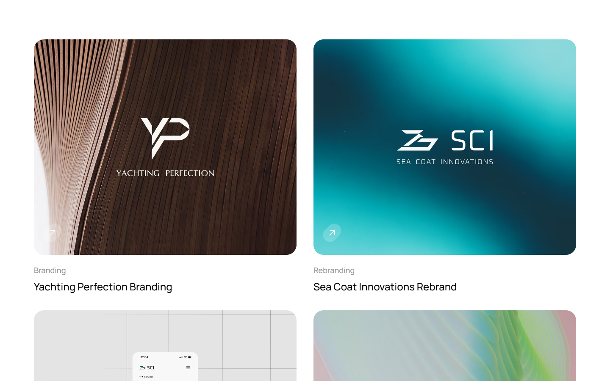
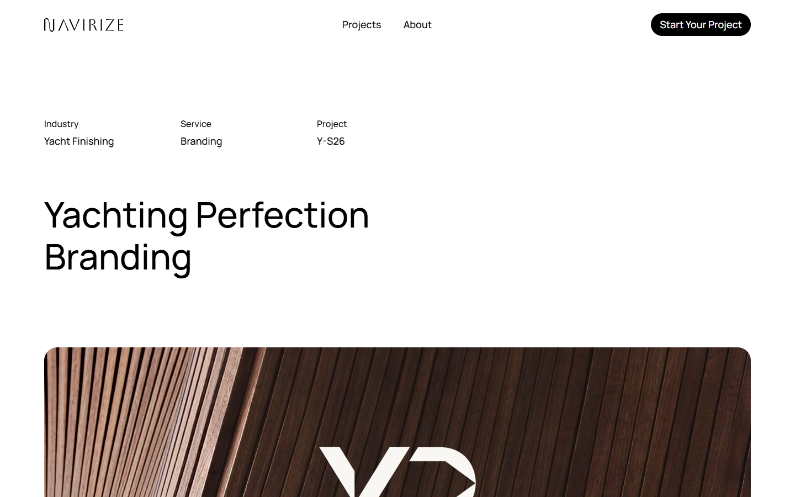
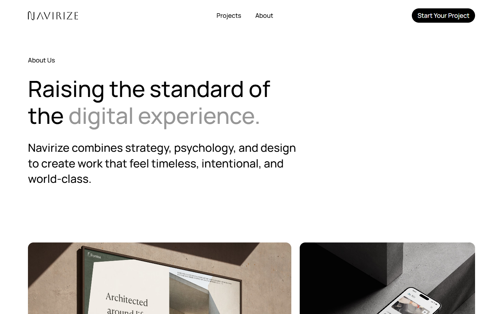
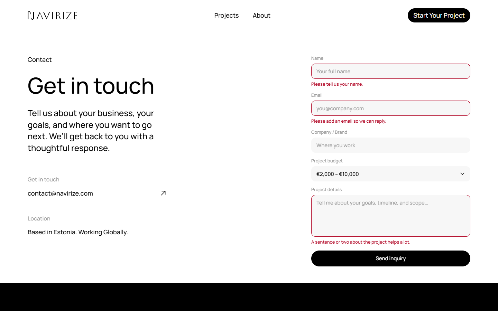
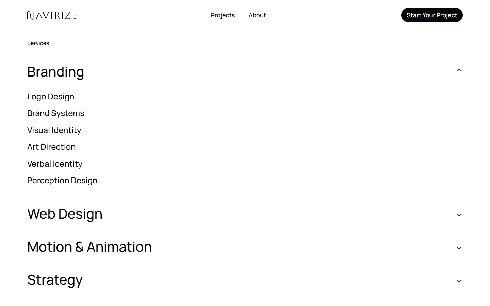
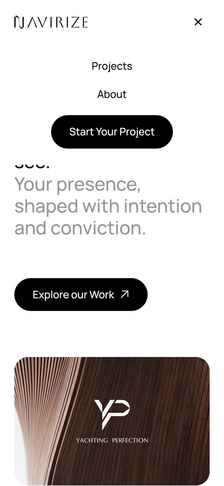
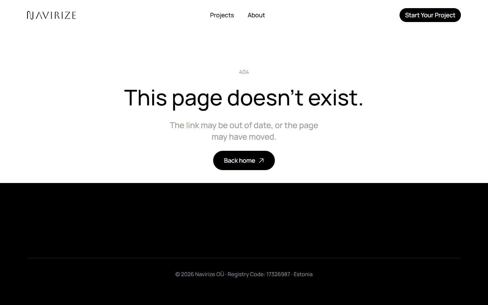
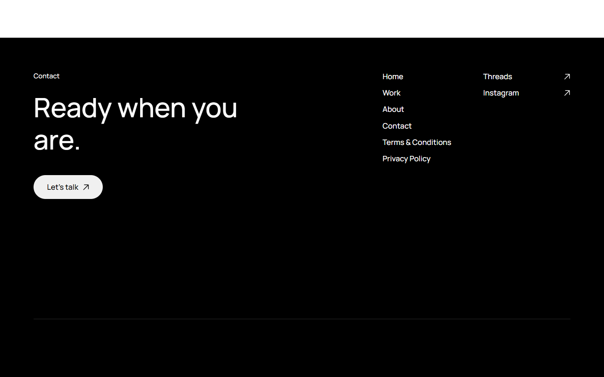

# Navirize site, rebuilt in React

A hand-coded React rebuild of Navirize, a branding and web design studio site first made in
Framer from the "Pearl" template. The client wanted the same look and, above all, the same
feel, but in code they own: no Framer runtime, a lighter page, and motion that matches the
original frame for frame. The hard part was not the layout. It was the scroll, reveal and
navigation motion that make the original feel calm, which Framer never documents.

I built it end to end. I measured the live site in headless Chrome (computed styles, element
boxes at 1440 and 390 wide, and animation values sampled frame by frame), then rebuilt the
eight routes, the reveal and scroll engine, the page transitions, the looping chrome brand
mark, the contact form and the image pipeline, and tuned each against the client's notes.



## What it does

**For visitors**
- A home page with the two-tone hero headline, a full-width featured project, a two-column
  grid of three more, "Shaping Perception", a four-row services accordion (Branding, Web
  Design, Motion & Animation, Strategy), "Our Story", the chrome "N" mark and the footer
- A projects index and four case studies (`/projects/:slug`), each with industry, service
  and project code, a hero image and an image gallery
- About, Contact, Terms, Privacy and a 404
- A contact form with name, email, company, budget (in euros) and project details, with
  inline errors and a sent state
- A nav that hides on scroll down and comes back on scroll up, or when the mouse moves
  within 90px of the top; on phones it opens a full-screen sheet that closes on Escape

**For the studio**
- All copy, projects, galleries, services and legal text live in `src/data/site.js`
- The form is ready for a backend: one commented `fetch('/api/inquiry')` line to swap in
- Per-route titles and descriptions, `ProfessionalService` JSON-LD, a sitemap and
  `robots.txt`

## How the motion works

**Reveals, one element at a time.** `Reveal.jsx` watches each animatable element on its own,
so a list arrives row by row as you reach it, not on a timer when its section appears.
Containers such as lists, accordions and galleries hand the reveal to their children. An
element starts once its top passes 85% of the way down the viewport. Pictures rise 30px and
text slides in 20px from the right. A shared requestAnimationFrame sweep backs up the
observer, so nothing can be left stuck at opacity 0.

**One curve for fade and travel.** Sampling the original showed its opacity always equals
`1 - y/30`: fade and movement share one progress function. The rebuild drives both from a
single 1.4s `linear()` timing function built from those samples, with a cubic-bezier
fallback. It is written as longhand properties so that an older Safari without `linear()`
drops only the curve, not the whole animation.

**Headlines by rendered line.** `lineStagger.jsx` splits headings into word spans, groups
them into lines after layout, and delays each line by 200ms. Whole words keep their kerning,
which per-glyph spans lose.

**Smooth wheel scroll.** `SmoothScroll.jsx` eases wheel input towards its target with a 130ms
time constant, fitted to the original's settle curve for one wheel notch. Touch, keyboard,
scrollbar and anchor jumps stay native, any scroll it did not cause re-anchors the target,
and a route change cancels a glide in progress.

**Page changes like a multi-page site.** Navigation holds the outgoing page for 250ms while it
fades, then swaps and scrolls to the top. Back and forward restore each history entry's
scroll position. The footer is fixed beneath the page, which slides away to uncover it.

**The chrome mark.** On the original, the "N" is a live WebGL shader. Here it is a 2x capture
of that canvas: VP9 with alpha for most browsers, and a white-matted H.264 clip for WebKit,
which ignores VP9 alpha. The capture has two hard cuts, so only the clean 2.9s to 10.2s window
plays. Two video elements take turns and cross-fade over 0.45s, so a loop never seeks while
visible.

**Images and loading.** Framer's CDN only resizes to fixed buckets, so `img()` and
`imgSrcSet()` in `site.js` build every URL from 512, 1024 and 2048 `scale-down-to` sizes. An
inline script preloads the hero image only on the home route. After load, on desktop and not
under Save-Data, `Prefetch.jsx` warms the images the next pages will need. Every animation
is switched off under `prefers-reduced-motion`.

## Stack

| Layer | Choice |
|---|---|
| Build | Vite 5, with React, router and app code split into three chunks |
| UI | React 18 |
| Routing | react-router-dom 6, 8 routes |
| Motion | CSS keyframes and `linear()` curves, no animation library |
| Styling | Plain CSS with custom properties |
| Fonts | Manrope variable, self-hosted latin subset |
| Hosting | Vercel (`vercel.json`) or Netlify (`public/_redirects`) |

## Engineering

- Production build: 74.5 KB of gzipped JavaScript across three chunks (react 45.6, app
  20.8, router 8.2) and 6.8 KB of gzipped CSS
- The self-hosted font is a single 24.8 KB woff2 file, preloaded
- `vercel.json` sets one-year immutable caching on `/assets`, `/fonts` and `/media`, plus
  Referrer-Policy, X-Content-Type-Options, X-Frame-Options and Permissions-Policy headers
- One `<h1>` per page, descriptive `alt` text on images, a skip link, and a honeypot
  field on the form
- No tests or CI in this repo

## Screenshots

| | |
|---|---|
|  |  |
| The home page project grid | Projects index |
|  |  |
| A case study | About |
|  |  |
| Contact form showing its inline errors | Services accordion, Branding open |
|  |  |
| Home on a phone | The phone menu sheet |
|  |  |
| 404 | The footer uncovered at the end of a page |

All screenshots show the site running locally with the copy and images that ship in the
repo. The company registration line in the footer is hidden in the footer shot. There is no
dark mode.

## Running it locally

```bash
git clone https://github.com/ashhhadd-210/navirize-react-clone.git
cd navirize-react-clone
npm install
npm run dev          # http://localhost:5173
```

`npm run build` writes the site to `dist/`, and `npm run preview` serves that build. There
are no environment variables. Client-side routes need a catch-all rewrite to `index.html`,
which both hosting configs include.

Images are still served from Framer's CDN and the copy is Navirize's. Replace both in
`public/` and `src/data/site.js` before any public deployment.
